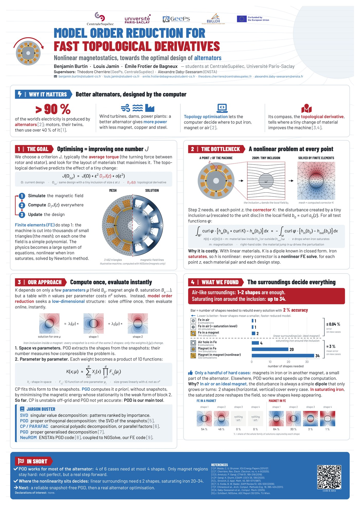

# Model order reduction for fast topological derivatives

*Nonlinear magnetostatics, towards the optimal design of alternators*

**Benjamin Burtin, Louis Jamin, Émile Frotier de Bagneux**, students at CentraleSupélec, Université Paris-Saclay  
Supervisors: Théodore Cherrière (GeePs, CentraleSupélec) · Alexandre Daby-Seesaram (ENSTA)  
Research track case study, 2026 (topic 10)

[](poster/poster.pdf)

*The poster (A0). Click for the full-resolution PDF.*

> The notebook and the report are written in French. This page summarises them in English.

## The question

Topology optimisation of an electric machine repeatedly asks: *what happens if a tiny piece of another material appears at point z?* The topological derivative answers this to first order, but each answer requires a nonlinear finite-element solve of a local exterior problem: a unit inclusion placed in the uniform field of the machine. This solve is repeated for every candidate point and every material configuration.

We ask whether these local solutions live in a **small, separable** space, so that a few precomputed shapes could replace thousands of finite-element solves.

## What we found

- **Most cases compress well.** Four of six material configurations need at most four POD modes for a 2 % error on the training grid. The two cases with magnets (a magnet in iron, and two nonlinear magnets) need 20 and 34 modes.
- **Test off the grid.** A CP/PARAFAC decomposition separates the parameters well on the training grid. Interpolating its factors between grid points is unstable, so compressing the data and predicting new cases are different problems.
- **A physics-based pilot runs but is not yet reliable.** NeuROM, which learns separated modes by minimising the magnetic energy without snapshots, is wired to the NGSolve mesh. Its optimisation must be stabilised before any speed-up can be claimed.

| Configuration (inclusion / exterior) | Parameters | Snapshots *P* | POD modes for 2 % | Worst error on 32 off-grid points |
|---|---|---:|---:|---:|
| Iron in air | *B*₀ | 9 | 1 | 0.04 % |
| Air in iron | *B*₀ | 9 | 4 | 6.29 % |
| Iron in air, variable saturation | *B*₀, *B*ₛ | 45 | 1 | 0.04 % |
| Permanent magnet in iron | *B*₀, *θ*ₘ | 144 | 20 | 10.33 % |
| Iron in permanent magnet | *B*₀, *θ*ₘ | 144 | 2 | 0.04 % |
| Nonlinear magnet in nonlinear magnet | *B*₀, *θ*ᵢₙ, *θ*ₒᵤₜ | 320 | 34 | 8.11 % |

Scope: this work studies the local exterior problem only. The full machine, the adjoint state and the optimisation loop are not included.

## Repository contents

- `final_notebook.ipynb`: the whole computation, from the mesh to the POD, CP and NeuROM results, with explanations and figures (in French).
- `poster/`: the A0 poster (PDF) and its preview image.
- `rapport/`: the report (LaTeX source, PDF and figures, in French). It contains no computation code: every number and figure comes from the notebook.

## Reproducing the results

Tested with Python 3.11.

```bash
python3.11 -m venv .venv
source .venv/bin/activate
python -m pip install --upgrade pip
python -m pip install -r requirements.txt
jupyter nbconvert --to notebook --execute final_notebook.ipynb \
  --inplace --ExecutePreprocessor.timeout=1200
```

A full run takes about four minutes on the authors' machine. The first cell prints the library versions actually loaded. Random seeds are fixed in the notebook; run times depend on the machine. If a run is interrupted, restart the kernel and run all cells, because later sections reuse the mesh and the reference solutions.

Each result in the report carries an identifier that can be searched in the notebook:

| Identifier | Result |
|---|---|
| `R1_VALIDATION` | mesh, analytic check and truncation radius |
| `R2_SNAPSHOTS` | the six parameter grids and their NGSolve snapshots |
| `R3_POD` | POD ranks, convergence in *P*, 32 off-grid points per case |
| `R4_CP` | CP/ALS rank sweep and factor interpolation |
| `R5_NEUROM` | energy-based NeuROM training and evaluation |

The report uses French abbreviations; the notebook uses English identifiers:

| Report | Notebook |
|---|---|
| Fe/Air | `iron_in_air` |
| Air/Fe | `air_in_iron` |
| Fe(*B*ₛ)/Air | `iron_in_air_Bs` |
| AP/Fe | `magnet_in_iron` |
| Fe/AP | `iron_in_magnet` |
| APNL/APNL | `nonlinear_magnet_in_nonlinear_magnet` |

To rebuild the report PDF: `cd rapport && tectonic rapport_reduction_correcteur_v2.tex`.

## Limitations

- A POD rank measures how well a subspace covers the snapshots; it does not predict the coefficients for a new parameter.
- Off-grid statistics use 32 Latin-hypercube points per case (seed `20260916`). They are not a uniform error bound.
- A small CP error on the grid does not guarantee stable interpolation of the factors.
- NeuROM is an integration pilot. Before comparing costs, the energy gradient should be checked, several initialisations compared, and the best models refined with L-BFGS.

## Main references

- P. Gangl, K. Sturm. Automated computation of topological derivatives with application to nonlinear elasticity and reaction–diffusion problems. *Computer Methods in Applied Mechanics and Engineering* 398, 115288 (2022).
- A. Daby-Seesaram, K. Škardová, M. Genet. Finite Element Neural Network Interpolation. Part II: Hybridisation with the Proper Generalised Decomposition for non-linear surrogate modelling. *Computational Mechanics* (2025), arXiv:2412.05714. NeuROM, the code accompanying this work: [doi:10.5281/zenodo.13772740](https://doi.org/10.5281/zenodo.13772740).
- J. Schöberl. C++11 implementation of finite elements in NGSolve. ASC Report 30/2014, TU Wien.
- L. Sirovich. Turbulence and the dynamics of coherent structures. Part I. *Quarterly of Applied Mathematics* 45, 561–571 (1987).
- T. G. Kolda, B. W. Bader. Tensor decompositions and applications. *SIAM Review* 51, 455–500 (2009).
- F. Chinesta, P. Ladevèze, E. Cueto. A short review on model order reduction based on PGD. *Archives of Computational Methods in Engineering* 18, 395–404 (2011).

The notebook cites the remaining sources where each method is introduced. To cite this work, use `CITATION.cff` (GitHub shows a "Cite this repository" button).

## License

Code: MIT License, see `LICENSE`. Report and figures in `rapport/`: Creative Commons Attribution 4.0 (CC BY 4.0).
